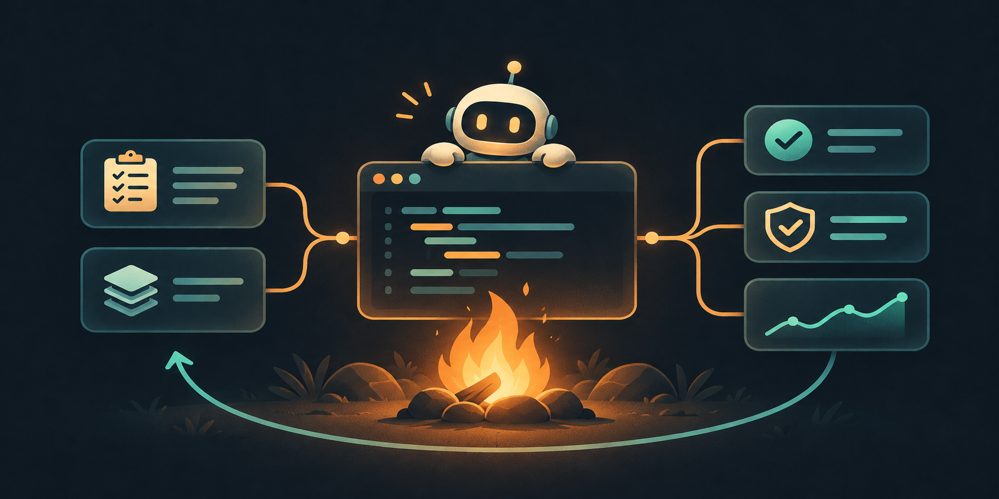

# 모닥랩 5기 스터디 회고

**Codex와 Claude Code를 활용한 AI 에이전트 하네스 성능 최적화**

## 스터디 주제와 목표

AI 에이전트가 코드를 작성하고 수정하는 과정에서, 어떤 규칙과 작업 맥락을 제공하고 결과를 어떻게 검증할지 공부했습니다. 이때 **코딩 하네스**는 에이전트의 개발 작업을 뒷받침하는 규칙, 스킬, 작업 맥락, 자동화, 검증 절차를 묶은 실행 환경을 뜻합니다.

같은 실습 과제의 **성공률 · 실행 시간 · 토큰 사용량**을 기준으로 삼고, 결과 품질을 유지하면서 시간과 비용을 줄이는 방법을 찾는 것이 목표였습니다.

## 주차별 계획과 진행사항

매주 수요일 오후 10시에 온·오프라인으로 모여 개인별 학습 내용을 발표하고 보고서를 취합했습니다. 첫 모임은 Google Meet에서 진행했고, 오프라인 모임 장소는 서현 캠퍼스였습니다.

| 주차 | OT에서 세운 계획 | 진행 내용과 결과물에 반영한 점 |
| --- | --- | --- |
| **1주차** | 하네스를 이해하고 공통 과제의 기준선 마련 | 팀원 모두 같은 프로젝트를 분석한 개인 보고서를 준비했습니다. 성공률, 실행 시간, 토큰 사용량을 비교 지표로 삼았습니다. |
| **2주차** | 프로젝트 규칙, 스킬, 에이전트 역할 설계 | 반복 작업에 필요한 규칙과 역할을 다뤘습니다. 최종 가이드에는 코딩 컨벤션, 디자인 시스템 규칙, 운영 역할별 책임을 정리했습니다. |
| **3주차** | 훅 기반 검증 자동화와 세션 간 메모리 설계 | 검증 자동화와 작업 맥락을 이어가는 방법을 다뤘습니다. 최종 가이드에는 품질 검사 실패 시 재시도하는 절차와 사람의 수정 내용을 규칙에 반영하는 절차를 담았습니다. |
| **4주차** | 모델 선택, 컨텍스트 관리, 서브에이전트 병렬 처리 비교 | 실행 성능을 개선하는 전략을 다뤘습니다. 최종 가이드에서는 한 번에 화면 하나를 처리하고, 코드 생성과 재시도에 필요한 파일만 전달하도록 정리했습니다. |
| **5주차** | 최적화와 품질·보안 검증을 통합하고 적용 전후 평가 | 코딩 하네스에서 다룬 원칙을 프런트엔드 개발에 적용해, 기획서·Figma 입력부터 PR 리뷰까지의 절차를 팀 운영 가이드로 정리했습니다. 적용 전후 실측 결과는 가이드에 기록되어 있지 않아 성능 개선 폭은 후속 검증 과제로 남았습니다. |

## 스터디 결과물

**팀 산출물 중 하나인 FE 개발 하네스 운영 가이드**는 스터디에서 다룬 코딩 하네스의 설계 원칙을 화면 단위 프런트엔드 개발에 적용한 문서입니다. 입력 준비, 코드 생성, 자동 검증, PR 리뷰까지 팀이 같은 기준으로 진행할 수 있도록 흐름을 정리했습니다.

- **입력과 토큰 관리** · 화면별 수용 기준과 Figma 프레임을 준비하고, 관련 컴포넌트와 타입만 전달합니다. 기획서와 디자인이 다르면 담당자에게 확인합니다.
- **품질·보안 검증** · 타입, 린트, 테스트, 시각 비교, 접근성을 확인합니다. 품질 실패는 정해진 범위에서 재시도하고, 보안 문제가 검출되면 실행을 차단해 담당자에게 넘깁니다.
- **PR과 운영 지표** · 검사 결과와 토큰 사용량을 PR에 남기고, 반복되는 수동 수정은 규칙에 반영합니다. 화면당 비용, 재시도 횟수, 검증 실패율, 머지까지 걸린 시간 등을 점검 지표로 삼았습니다.

[FE 개발 하네스 통합 시스템 최종 운영 가이드 (PDF)](./FE%20%EA%B0%9C%EB%B0%9C%20%ED%95%98%EB%84%A4%EC%8A%A4%20%ED%86%B5%ED%95%A9%20%EC%8B%9C%EC%8A%A4%ED%85%9C%20%EC%B5%9C%EC%A2%85%20%EC%9A%B4%EC%98%81%20%EA%B0%80%EC%9D%B4%EB%93%9C.pdf)

## 멤버별 한 줄 회고

아래는 스터디 주제와 각자의 역할을 바탕으로 작성한 회고 초안입니다.

| 멤버 | 맡은 역할 | 한 줄 회고 초안 |
| --- | --- | --- |
| **김다롬** | 장소 예약 | 업무에서 큰 PR의 코드리뷰를 여러 그룹으로 나눠 진행해봤는데, 각 그룹에 공통 문서를 전달하다 보니 리뷰 시간은 줄지 않고 토큰 사용량은 오히려 늘었습니다. 이번 스터디를 통해 코드리뷰 스킬의 시작 단계에서 메인 에이전트가 분할 계획을 한 번 세우고, 각 리뷰 에이전트에는 담당 diff와 적용할 규칙만 전달하는 컨텍스트 전략을 구체화할 수 있었습니다. 특히 리뷰를 병렬로 돌릴지 결정하는 것만큼, 각 에이전트가 어떤 정보를 읽어야 하는지 설계하는 게 중요하다는 점이 인상적이었습니다.  |
| **김민지** | 지난주 학습 내용 리마인드 |5주 동안 Codex와 Claude Code로, 기획서와 Figma 디자인을 넣으면 FE 코드가 나오는 하네스를 만들어 봤습니다. 주차가 진행되며 토큰을 아끼는 방법과 품질·보안을 검사하는 방법을 하나씩 붙여 나갔고, 마지막에는 운영 가이드로 정리해 보았습니다. 보면서 가장 크게 느낀 건, 결과물의 품질이 모델이 얼마나 똑똑한지보다 입력을 얼마나 잘 정리해서 주고 나온 결과를 얼마나 잘 걸러내느냐에 더 달려 있다는 점이었습니다. 그중에서도 제일 좋았던 경험은 훅으로 테스트 자동화를 구성해 본 부분입니다. 검증을 사람이 기억해서 챙기는 대신 훅에 맡겨 두니 매번 자동으로 걸려서, 안정적인 하네스를 만들고 쉽게 검증할 수 있었습니다. |
| **박병찬** | 진행 관리 | 최적화 효과를 확인하려면 같은 과제에서 성공률과 시간, 토큰 사용량을 함께 기록해야 한다는 점이 인상적이었습니다. |
| **박소연** | 보고서 작성 | 사이드 프로젝트에서 Android 개발을 담당하며 iOS 데스크톱 앱을 개발하는 팀원과 함께 하나의 서비스를 만들어 가고 있습니다.

이번 스터디에서는 개발 과정에서 반복적으로 발생하는 디자인 및 기능 QA 업무에 하네스를 적용해 보는 경험을 했습니다.

기존에는 한 플랫폼에서 발견된 이슈를 각자 확인하고 수정한 뒤, 다른 플랫폼에서도 동일하게 동작하는지 별도로 확인해야 했습니다. 특히 디자인이나 기능 관련 QA 이슈가 발생하면 내용을 공유하고, 수정 여부를 확인하고, 다른 플랫폼과의 동작 차이까지 비교하는 과정에서 생각보다 많은 리소스가 소요되더라고요.

이를 개선하기 위해 Notion에 정리된 QA 양식을 입력으로 활용하는 하네스를 구성했습니다.

하나의 플랫폼에서 발견된 이슈가 Notion QA 양식에 맞춰 등록되면, 해당 내용을 기반으로 담당 플랫폼에서 수정 작업을 진행하고 수정 결과를 검증하도록 했습니다. 여기에 그치지 않고 다른 플랫폼의 동일한 기능과 디자인도 함께 크로스체크할 수 있도록 구성했습니다.

덕분에 이슈 내용을 매번 다시 파악하고 플랫폼별로 확인하는 반복 작업을 줄일 수 있었고, 한 번의 QA 이슈를 여러 플랫폼의 관점에서 확인할 수 있어 기능 검증에 필요한 리소스도 절약할 수 있었습니다.

이번 스터디를 통해 느낀 점은 하네스가 단순히 코드를 자동으로 작성하거나 수정해 주는 도구가 아니라, 개발 과정에서 반복되는 업무와 검증 절차 자체를 효율적으로 설계하는 방법이라는 점이었습니다.

특히 Android와 iOS처럼 서로 다른 플랫폼을 함께 개발하는 환경에서는 한쪽의 수정만으로 끝내지 않고, 다른 플랫폼과의 일관성까지 검증하는 과정이 중요하다고 생각합니다.

앞으로도 QA 과정에서 반복적으로 발생하는 작업을 하네스로 조금씩 자동화하고, 단순히 개발 시간을 줄이는 것을 넘어 플랫폼 간 품질을 일정하게 유지할 수 있는 방향으로 발전시켜 보고 싶습니다.. |
